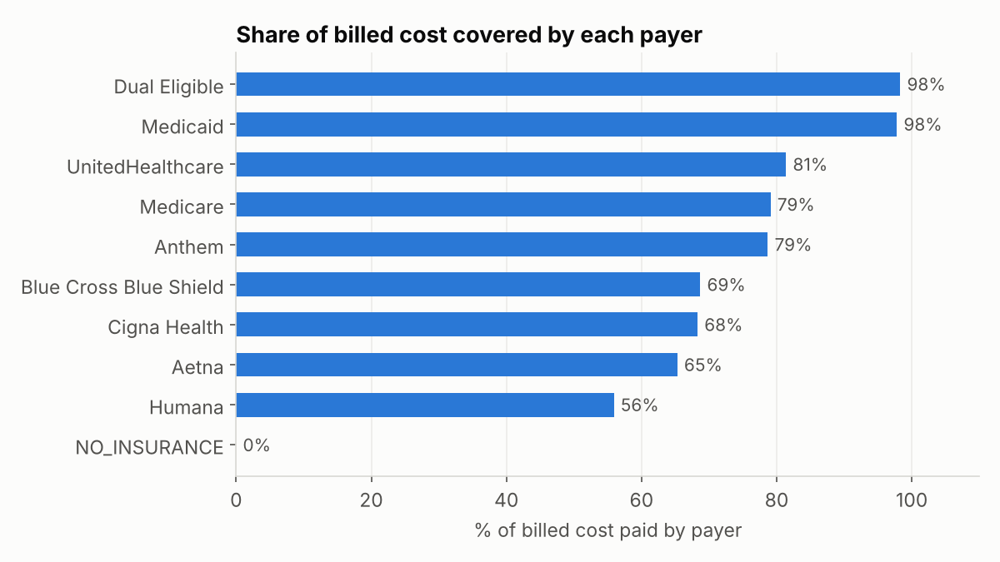

# Healthcare Claims & Clinical Analytics
**Question:** Where does healthcare spending go, who pays for it, and which patients drive cost and readmissions?

**Data:** [Synthea](https://synthetichealth.github.io/synthea/) synthetic patient records: 18 related tables covering patients, encounters, diagnoses, lab results, medications, providers, payers and insurance claims (~200K rows). The data is synthetic, so there are no real patients, but the structure matches the EHR and claims data used in hospital analytics.

**Tools:** SQL (DuckDB): multi-table JOINs, CTEs, `LEAD` / `NTILE` / window aggregates, conditional aggregation · Python: pandas, matplotlib


## Key findings
- **Care setting volume and cost:** Ambulatory (clinic) care is about two-thirds of total spend. That's because of volume: inpatient and skilled-nursing stays cost far more *per visit*, but they're rare.
- **Payer mix:** Coverage varies a lot by payer. Medicaid and dual-eligible plans cover ~98% of billed cost, while Humana covers ~56%, which leaves a large patient-responsibility balance. Uninsured encounters are 100% patient responsibility.
- **Most common diagnoses:** Dental and acute respiratory conditions dominate by patient count. Chronic conditions like hypertension affect fewer patients but drive ongoing cost.
- **Provider workload:** Patient volume is concentrated in a handful of general-practice providers. A view like this is the starting point for staffing and capacity planning.
- **Emergency visit trend:** ER volume is noisy at this sample size (~110 patients). A real analysis would normalize per 1,000 patients before calling it a trend.
- **30-day readmission rate:** The 30-day readmission rate was about 6% of inpatient stays. `LEAD()` pairs each stay with the patient's *next* admission, which is the same logic behind CMS's Hospital Readmissions Reduction Program measure.
- **High-cost patient concentration:** **The top 10% of patients account for ~40% of all spending**, and the top 20% for ~58%. This concentration is why care-management programs target high-cost patients first.
- **Diabetes cohort analysis:** Diabetic patients cost ~50% more per patient than everyone else. Interestingly, their average HbA1c is *lower* than the prediabetes group's. That's likely a treatment effect: diagnosed patients are on medication, and the average spans years of readings. A next step would be comparing A1c before vs. after diagnosis date.




## SQL techniques used
Multi-table JOINs (encounters → providers → organizations), `LEAD()` for readmission logic, `NTILE()` for cost deciles, multi-CTE cohort building, conditional aggregation with `FILTER`/`BOOL_OR`, `TRY_CAST` on messy lab values, pandas cross-validation of SQL results

## Files
- [`analysis.ipynb`](analysis.ipynb): every query, its output, charts, and written findings
- `setup_data.py`: downloads the source data and builds `data/healthcare.duckdb`

## Run it
```bash
pip install -r ../requirements.txt
python setup_data.py
jupyter notebook analysis.ipynb
```

*Synthea regenerates its public sample periodically, so re-running setup may produce slightly different numbers.*
