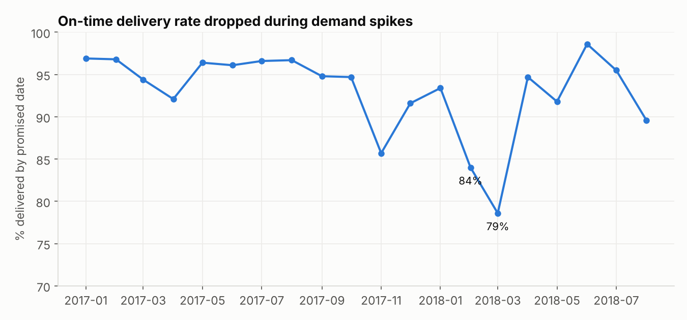

# E-commerce Operations & Delivery Performance
**Question:** Is the business growing, are we hitting our delivery promises, and what does missing them cost us in customer satisfaction?

**Data:** [Olist Brazilian E-Commerce](https://www.kaggle.com/datasets/olistbr/brazilian-ecommerce): ~100K real, anonymized marketplace orders (2016–2018) across 8 related tables covering orders, line items, payments, reviews, products, sellers and customers.

**Tools:** SQL (DuckDB): JOINs across 4+ tables, CTEs, `RANK`, window percentages, `HAVING`, date math · Python: pandas, matplotlib

This analysis treats the business like a set of operational KPIs (on-time delivery rate as an SLA, seller scorecards, regional performance), which is the same kind of tracking used in business and project-management analytics.

## Key findings
- **Monthly orders and revenue:** Monthly orders grew ~8x from January 2017 to the 2018 plateau of ~6–7K orders, with a Black Friday spike in November 2017.
- **On-time delivery rate by month (SLA tracking):** On-time delivery is usually 92–97%, but it fell to **86% during the November 2017 Black Friday spike and to 84% / 79% in February / March 2018**. Operations didn't keep up when volume jumped.
- **Does late delivery hurt customer satisfaction?** **This is the headline finding.** On-time orders average 4.29 stars. Orders 8+ days late average 1.70, and 79% of them get a 1- or 2-star review. Delivery reliability is a major driver of customer satisfaction in this data.
- **Revenue by product category:** Health & beauty and watches/gifts lead revenue. Watches/gifts gets there with the highest average item price (~R$201).
- **Seller scorecard:** A simple seller scorecard: rank by revenue, flag anyone above a 12% late rate or below a 3.8-star average. The #5 seller by revenue gets flagged for a 3.50 average review, which makes it a priority for an account-management conversation.
- **Customer retention:** **Only 3% of customers ever order a second time.** The business runs almost entirely on new-customer acquisition, which makes retention the clearest growth opportunity.
- **Delivery performance by state:** São Paulo (SP) customers get orders in ~9 days. Northern and northeastern states wait 20+ days and see 2–3x the late rate, which points to a logistics/fulfillment-network gap rather than a seller problem.
- **Payment methods:** Credit card is 75% of orders, averaging 3.5 installments. Boleto (a Brazilian cash/bank-slip method) is the main alternative at ~20%.




## SQL techniques used
4-table JOINs, CTEs, `RANK()` and window percentages (`SUM(...) OVER ()`), `HAVING` thresholds, date arithmetic for SLA measurement, CASE bucketing, KPI/scorecard design, pandas merge/groupby cross-check

## Files
- [`analysis.ipynb`](analysis.ipynb): every query, its output, charts, and written findings
- `setup_data.py`: downloads the source data and builds `data/ecommerce.duckdb`

## Run it
```bash
pip install -r ../requirements.txt
python setup_data.py
jupyter notebook analysis.ipynb
```
