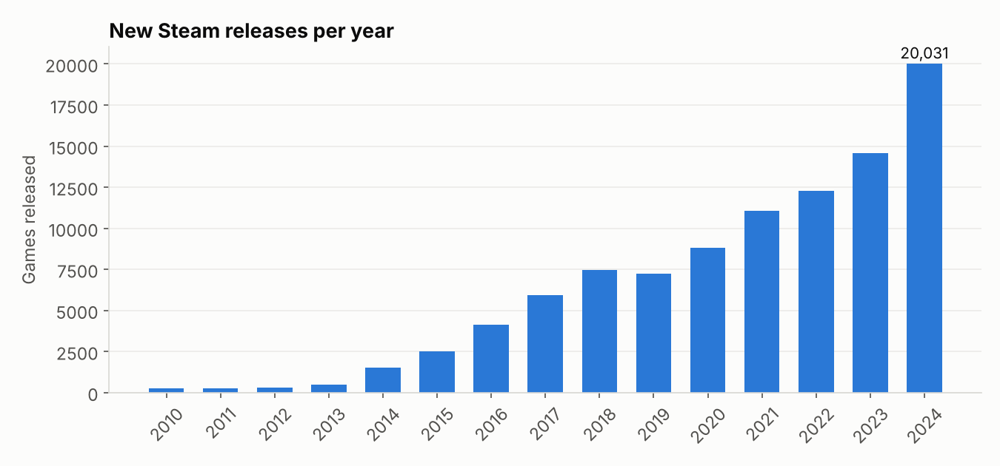

# Steam Gaming Market Analysis
**Question:** What does the PC game market look like, and what separates the games that reach a large audience from the rest?

**Data:** [Steam Games Dataset](https://huggingface.co/datasets/FronkonGames/steam-games-dataset) (MIT license): ~124K games with price, genres, publishers, review counts, estimated owners, playtime and achievements. Owner counts are Steam's estimated *ranges*; this analysis uses the lower bound. Prices are as captured in the dataset snapshot.

**Tools:** SQL (DuckDB): `UNNEST` on array columns, `ROW_NUMBER` top-N-per-group, `MEDIAN`, CASE bucketing, `HAVING` · Python: pandas, matplotlib

## Key findings
- **Releases per year:** Annual releases grew from ~250 in 2010 to **20,000+ in 2024**. The market is extremely crowded, so discoverability is the core problem for new games.
- **Free vs paid:** Free-to-play games are more likely to reach 1M+ owners (6.8% vs 4.0%) but review worse (81% vs 88% positive). Free removes the purchase barrier but attracts less committed players.
- **Genre landscape:** Indie is by far the largest genre. RPG and Strategy games get the most playtime (~3 median hours), while Massively Multiplayer has the weakest reception (74% positive).
- **Pricing vs reception:** Higher-priced games are much more likely to be hits (16% of $30–49.99 games reach 1M+ owners vs 3% under $5) but review *slightly worse*. Expectations rise with price.
- **Top publishers by hits:** Electronic Arts has the most 1M+ owner games, but Valve's 32 hits generate ~4x more reviews than EA's 52. Hit count and hit size are different measures of success.
- **Best-reviewed game in each genre:** `ROW_NUMBER() OVER (PARTITION BY genre ...)` returns the top game in each genre in one query. Free-to-play titles (Counter-Strike 2, Dota 2, PUBG) lead most genres by review volume.
- **Does content depth drive engagement?** Games with more achievements see ~2.7x more median playtime (4.6 vs 1.7 hours). That's a correlation, not causation: bigger games tend to have both.





## SQL techniques used
`UNNEST` to normalize array columns (genres, publishers), `ROW_NUMBER()` top-N-per-group, `MEDIAN`, CASE price bucketing, parsing text ranges and dates during load, pandas cross-check

## Files
- [`analysis.ipynb`](analysis.ipynb): every query, its output, charts, and written findings
- [`practice.ipynb`](practice.ipynb): 6 hands-on SQL challenges plus an open-ended question, with an answer checker [](https://colab.research.google.com/github/daxonmahone-hub/data-analytics-portfolio/blob/main/03-steam-gaming-market-analysis/practice.ipynb)
- `setup_data.py`: downloads the source data and builds `data/steam.duckdb`

## Run it
```bash
pip install -r ../requirements.txt
python setup_data.py
jupyter notebook analysis.ipynb
```
