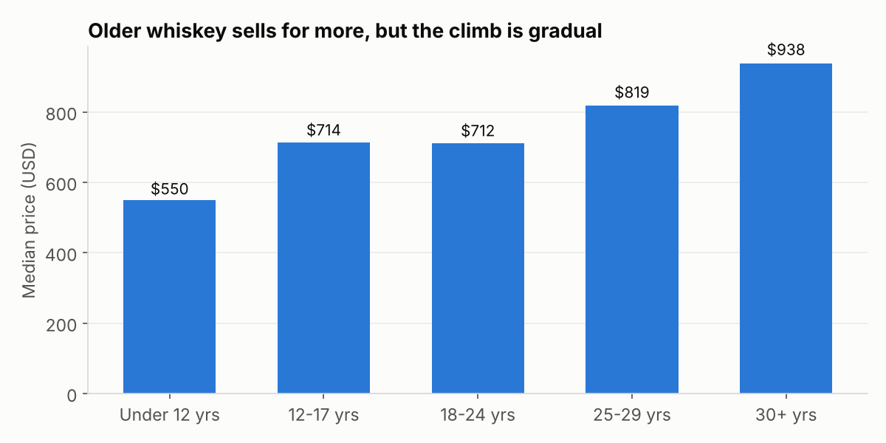

# Is Rare Whiskey Actually a Good Investment?

**Where the idea came from:** I work at a whiskey bar and study Finance. Some rare bottles sell for thousands at auction, so I wanted to know whether rare whiskey is actually a good investment.

**Data:** [DramValue Whisky Prices](https://huggingface.co/datasets/datamatters24/dramvalue-whisky-prices) (public domain): ~30,000 bottles and 1.35 million auction and retail sales, compared against [S&P 500 index data](https://github.com/datasets/s-and-p-500).

## Answer
**No, not compared to the stock market.** Tracking the same bottles' auction prices year over year, rare whisky grew about **3.4% a year from 2013 to 2025, vs. 11.7% for the S&P 500**. $100 in 2013 became about $149 in whisky vs. about $378 in stocks.

## Findings
- **Whisky booms, then busts.** Prices jumped in 2016–2017 (+12%, +20%) and 2020–2021 (+13%, +12%), then fell every year from 2022 to 2024.
- **Age matters, but gradually.** 30+ year bottles have a median of $938, about 1.7x bottles under 12 years ($550).
- **Bourbon is the collector's market.** The typical collectible bourbon sells for ~2.7x the typical Scotch single malt ($483 vs. $182).
- **The naive approach is wrong.** The median sale price per year jumps around because *which* bottles get recorded changes. Comparing the same bottle to itself (like a home-price index) fixes that.

## How it was built
| Step | Question | SQL skill |
|---|---|---|
| 1 | What's in the data, and is it reliable? | SELECT, WHERE, ORDER BY, `COUNT(*) FILTER` |
| 2 | Which whiskey types are worth the most? | GROUP BY, MEDIAN, HAVING |
| 3 | Does age raise the price? | CASE buckets |
| 4 | How has the auction market grown? | JOIN (prices ↔ bottles), date functions |
| 5 | Whiskey vs. the S&P 500 | CTEs, `LAG()` window function, compounding in pandas |

## Limitations
- Only ~30–70 bottles per year have enough back-to-back sales to compare.
- Some listings lump related releases together, which adds noise. The data reflects the collector auction market, not shelf prices.
- The returns leave out auction fees, storage, and insurance for whisky, and dividends for stocks.

## Next questions
- Do bourbon and Scotch behave differently as investments?
- Do limited releases hold their value better?
