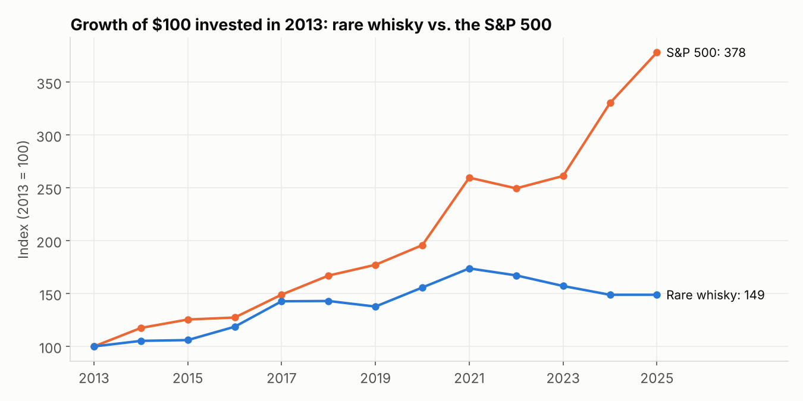

# Dax Mahone — Data Analytics Portfolio

Finance & Data Science student at UNC Charlotte. This repo contains SQL + Python analyses of real-world-style datasets across healthcare, business operations, and gaming. Each project starts from business questions, answers them with queries, and ends with findings someone could act on.

**Skills shown:** SQL (JOINs, CTEs, window functions: `LEAD`, `RANK`, `ROW_NUMBER`, `NTILE`; aggregation, `HAVING`, date logic) · Python (pandas, matplotlib, Jupyter) · DuckDB · KPI design · data cleaning · communicating findings

---

## Projects

### ⭐ Featured: [Is Rare Whiskey Actually a Good Investment?](04-whiskey-investment-analysis/)
*Finance · auction market analysis · 1.35M real sales*

I compared rare whiskey auction prices against the S&P 500 by tracking the same bottles year over year.
- Rare whisky grew **~3.4% a year vs. 11.7% for the S&P 500** (2013–2025)
- Prices boomed in 2016–17 and 2020–21, then fell every year from 2022 to 2024
- 30+ year bottles sell for ~1.7x bottles under 12 years



### 1. [E-commerce Operations & Delivery Performance](02-ecommerce-operations-analysis/)
*Business operations · KPI / SLA tracking · ~100K real orders, 8 tables*

Tracked on-time delivery as an SLA, built a seller scorecard, and measured how delivery delays affect customer satisfaction.
- Orders 8+ days late average **1.70 stars vs. 4.29** for on-time orders
- On-time rate fell from ~96% to **79%** during demand spikes
- Only **3%** of customers ever order a second time


### 2. [Healthcare Claims & Clinical Analytics](01-healthcare-claims-analysis/)
*Healthcare · EHR + insurance claims · 18 tables, ~200K rows (Synthea synthetic data)*

Analyzed spending by care setting and payer, calculated a CMS-style 30-day readmission rate, and built a diabetes patient cohort.
- The **top 10% of patients drive ~40%** of total spend
- Payer coverage ranges from **56% to 98%** of billed cost
- Diabetic patients cost **~50% more** per patient


### 3. [Steam Gaming Market Analysis](03-steam-gaming-market-analysis/)
*Gaming · market & pricing analysis · ~124K games*

Sized the PC game market and examined what separates games that reach 1M+ players from the rest.
- New releases grew from ~250 (2010) to **20,000+ (2024)**
- $30–49.99 games are **5x more likely** to reach 1M+ owners than games under $5
- Free-to-play reaches more players but reviews worse (81% vs. 88% positive)


---

## Hands-on practice
Each project also has a `practice.ipynb` with 6 SQL challenges that aren't answered in this repo, plus one open-ended question. They go from warm-up queries to window functions and multi-table capstones. A built-in checker confirms answers using hashes only, so it never reveals the solution. They run in the browser with no setup:

| Project | Practice notebook |
|---|---|
| E-commerce operations | [](https://colab.research.google.com/github/daxonmahone-hub/data-analytics-portfolio/blob/main/02-ecommerce-operations-analysis/practice.ipynb) |
| Healthcare claims | [](https://colab.research.google.com/github/daxonmahone-hub/data-analytics-portfolio/blob/main/01-healthcare-claims-analysis/practice.ipynb) |
| Steam gaming market | [](https://colab.research.google.com/github/daxonmahone-hub/data-analytics-portfolio/blob/main/03-steam-gaming-market-analysis/practice.ipynb) |

---

## Run it yourself
```bash
pip install -r requirements.txt
cd 02-ecommerce-operations-analysis
python setup_data.py          # downloads the data and builds a local DuckDB database
jupyter notebook analysis.ipynb
```
Each project folder works the same way. `setup_data.py` downloads the data from its original public source (the healthcare project uses a pinned snapshot stored in the repo, so its numbers always match).

## Contact
[LinkedIn](https://www.linkedin.com/in/dmahone) · daxonmahone@gmail.com
